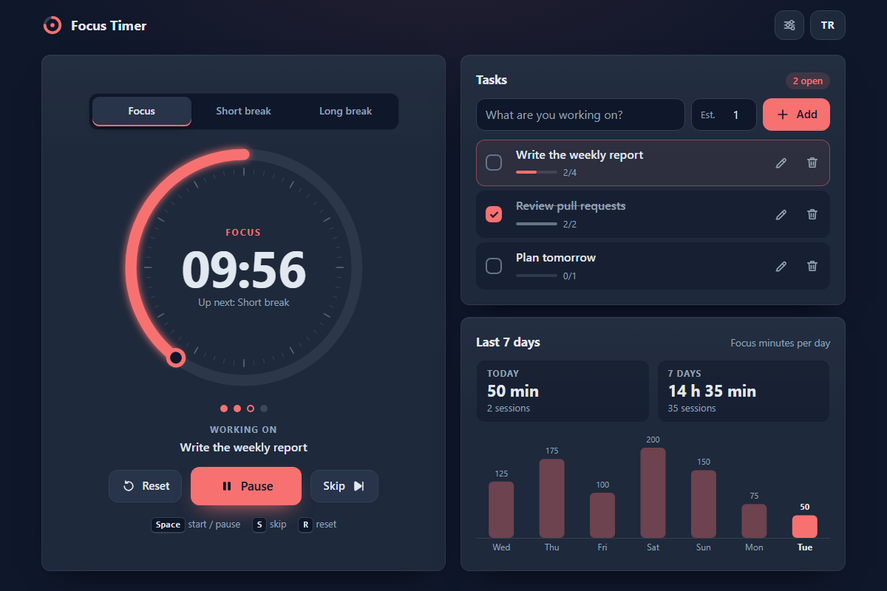

# Focus Timer - a calm interval timer with breaks, tasks and a 7-day chart, right in your browser

[](#tests)
[](LICENSE)

**▶ Open the app: https://celaldrg.github.io/focus-timer/**



## Features

- **Focus sessions and breaks**: Focus, Short break and Long break modes. After a set number of focus sessions (4 by default) a long break comes up instead of a short one; the dots under the ring show where you are in the cycle.
- **Progress ring**: an SVG ring shows the time that is left, and the browser tab title shows it too, so you can see it from another tab.
- **Accurate timing**: the time left is worked out from timestamps, not by counting ticks, so the timer does not drift when the tab sleeps in the background. A session that ended while the page was hidden is completed at its exact end time.
- **End of session**: a short chime (Web Audio, no sound files) and, if you turn it on, a system notification. The browser asks for notification permission only when you switch notifications on in Settings.
- **Task list**: add tasks with an estimate of focus sessions, pick the active task, edit, tick off or delete tasks. Each completed focus session is credited to the active task.
- **7-day chart**: focus minutes per day for the last week, with today's and the week's totals. Time is split at local midnight, so a late session counts on the right days. Only focus sessions that run to the end count; skipped ones do not.
- **Settings**: the length of each session type, the long-break interval, auto-start for breaks and for focus sessions, the chime and notifications. A session that has already started keeps its length.
- **English and Turkish**: the TR / EN button switches every string and remembers your choice.
- **Private**: no account and no server. Settings, tasks and statistics stay in your browser's localStorage, and the app keeps working in private mode, where storage may be blocked.
- **Demo**: open [`?demo`](https://celaldrg.github.io/focus-timer/?demo) to see a running focus session at about 60 %, three tasks and a filled week. The demo does not touch your own saved data.

## How to use

**Keyboard** (desktop)

| Key | Action |
| --- | --- |
| `Space` | Start or pause the timer |
| `S` | Skip to the next session (it is not counted) |
| `R` | Reset the session to its full length; on a session that has not started, start a fresh cycle |
| `Tab`, `Enter` | Move between and press the buttons |
| `Escape` | Close a dialog, or cancel editing a task |

The shortcuts are off while you type in a text field or while a dialog is open. When you reach a button with `Tab`, `Space` presses that button, while `S` and `R` keep working.

**Touch and mouse**

- Tap the ring, or the big button, to start or pause.
- Use the buttons next to it to reset or skip, and the tabs above the ring to switch the session type. While a session is running or paused, the tabs ask before they switch, because the interrupted session is not counted.
- Tap a task's title to make it the active task, the box to tick it off, the pencil to edit it and the bin to delete it.
- The sliders button in the header opens Settings; the TR / EN button changes the language.

## Run locally

The app is plain HTML, CSS and JavaScript modules, with no build step and no dependencies. Serve the folder with any static web server, for example:

```sh
npx serve .
```

Then open the address it prints. ES modules need `http://`; opening `index.html` straight from disk (`file://`) does not work.

## Tests

```sh
node --test
```

The tests use Node's built-in test runner (CI runs Node 22) and need no packages. They cover:

- the timer state machine: start, pause, resume, skip, reset, mode changes (and which of them would throw away a started session), auto-start, the long-break cycle, drift-free timing and exact session ends, all with injected timestamps;
- settings validation, the task list, daily statistics split at local midnight and the 7-day window;
- saving and restoring the state, and the storage wrapper when localStorage throws;
- the app model with an injected clock and storage;
- the English and Turkish string tables (same keys and placeholders), labels, the chart layout, the keyboard shortcut rules and the demo state;
- the chime, with a fake AudioContext: it starts audio only inside a user gesture.

## Project structure

```text
focus-timer/
├── index.html            page markup; every visible string is translated at runtime
├── style.css             dark theme, mobile first
├── src/
│   ├── timer.js          pure timer state machine
│   ├── settings.js       default settings and validation
│   ├── tasks.js          task list
│   ├── stats.js          daily focus totals
│   ├── state.js          saving and restoring the whole state
│   ├── app.js            app model with an injectable clock and storage
│   ├── storage.js        localStorage wrapper that never throws
│   ├── i18n.js           English and Turkish strings
│   ├── labels.js, chart.js, shortcuts.js, demo.js            pure helpers for the UI
│   └── main.js, timer-view.js, tasks-view.js, stats-view.js,
│       settings-dialog.js, confirm-dialog.js, alerts.js,
│       dom.js, icons.js                                      DOM code
├── test/                 node:test suites
└── docs/screenshot.png
```

## License

[MIT](LICENSE) © 2026 Celalettin Durgaç

## Türkçe

Odak oturumları, molalar, görev listesi ve 7 günlük grafikle sakin bir aralık zamanlayıcısı; tarayıcıda çalışır.

**▶ Uygulamayı aç: https://celaldrg.github.io/focus-timer/**

### Özellikler

- **Odak ve mola**: Odak, Kısa mola ve Uzun mola modları. Belirli sayıda odak oturumundan sonra (varsayılan 4) kısa mola yerine uzun mola gelir; halkanın altındaki noktalar döngüde nerede olduğunu gösterir.
- **İlerleme halkası**: SVG halka kalan süreyi gösterir; kalan süre sekme başlığında da yazar.
- **Kaymayan süre**: kalan süre zaman damgalarından hesaplanır, sekme arka planda uyusa da zamanlayıcı kaymaz. Sayfa gizliyken biten oturum tam bitiş anında kapanır.
- **Oturum sonu**: kısa bir zil sesi (Web Audio, ses dosyası yok) ve istersen sistem bildirimi. Tarayıcı bildirim iznini yalnızca Ayarlar'da bildirimleri açtığında sorar.
- **Görev listesi**: tahmini oturum sayısıyla görev ekle, etkin görevi seç, görevleri düzenle, tamamla ya da sil. Biten her odak oturumu etkin göreve yazılır.
- **7 günlük grafik**: son haftanın günlük odak dakikaları, bugünün ve haftanın toplamları. Süre yerel gece yarısında bölünür; yalnızca sonuna kadar süren odak oturumları sayılır, atlananlar sayılmaz.
- **Ayarlar**: oturum süreleri, uzun mola aralığı, molaları ve odak oturumlarını otomatik başlatma, zil sesi ve bildirimler. Başlamış bir oturum kendi süresini korur.
- **İngilizce ve Türkçe**: TR / EN düğmesi bütün metinleri değiştirir ve seçimini hatırlar.
- **Gizlilik**: hesap ve sunucu yok. Ayarlar, görevler ve istatistikler tarayıcının localStorage'ında kalır; depolamanın kapalı olduğu gizli modda da uygulama çalışır.
- **Demo**: [`?demo`](https://celaldrg.github.io/focus-timer/?demo) adresi yaklaşık %60'ta çalışan bir odak oturumu, üç görev ve dolu bir hafta gösterir; kendi kayıtlı verine dokunmaz.

### Nasıl kullanılır

**Klavye** (masaüstü): `Boşluk` başlatır ya da duraklatır, `S` sonraki oturuma atlar (atlanan oturum sayılmaz), `R` oturumu baştan alır (başlamamış oturumda yeni döngü başlatır). `Tab` ve `Enter` düğmeler arasında gezinir ve basar, `Escape` açık pencereyi kapatır ya da görev düzenlemeyi iptal eder. Metin yazarken ve bir pencere açıkken kısayollar çalışmaz; `Tab` ile bir düğmeye gelince `Boşluk` o düğmeye basar, `S` ve `R` çalışmaya devam eder.

**Dokunmatik ve fare**: halkaya ya da büyük düğmeye dokununca zamanlayıcı başlar ya da durur. Yanındaki düğmeler baştan alır ya da atlar; halkanın üstündeki sekmeler oturum türünü değiştirir. Bir oturum sürerken ya da duraklatılmışken sekmeler geçmeden önce onay ister, çünkü yarıda kalan oturum sayılmaz. Görevin adına dokunmak onu etkin görev yapar; kutu görevi tamamlar, kalem düzenler, çöp kutusu siler. Başlıktaki ayar düğmesi Ayarlar'ı açar, TR / EN düğmesi dili değiştirir.

### Yerelde çalıştırma

Derleme adımı ve bağımlılık yok. Klasörü herhangi bir statik sunucuyla aç, örneğin `npx serve .`, sonra yazdığı adrese git. ES modülleri `http://` ister; `index.html` dosyasını diskten (`file://`) açmak çalışmaz.

### Testler

`node --test` (Node'un yerleşik test aracı; CI Node 22 kullanır; paket gerekmez). Testler zamanlayıcı durum makinesini, ayar doğrulamasını, görev listesini, günlük istatistikleri, kaydetme ve geri yüklemeyi, depolama sarmalayıcısını, uygulama modelini, İngilizce ve Türkçe metin tablolarını, grafik yerleşimini, klavye kısayollarını, demo durumunu ve sahte bir AudioContext ile zil sesinin yalnızca bir kullanıcı hareketiyle başladığını kapsar.

### Lisans

[MIT](LICENSE) © 2026 Celalettin Durgaç
